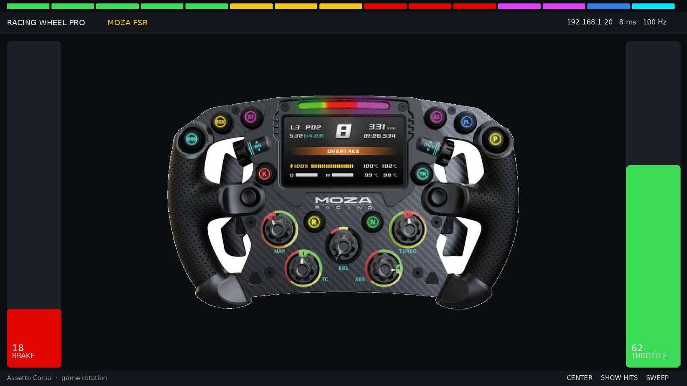
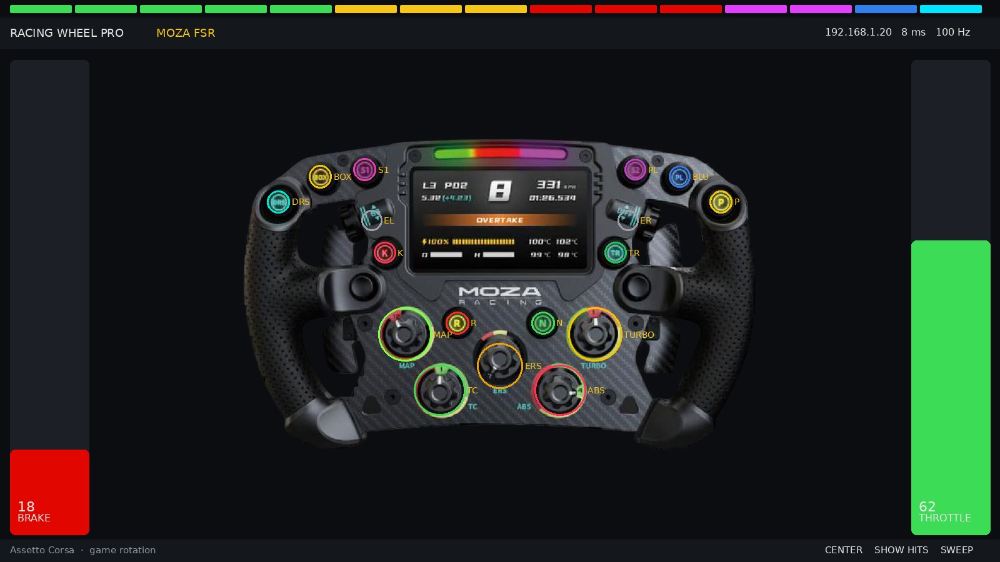
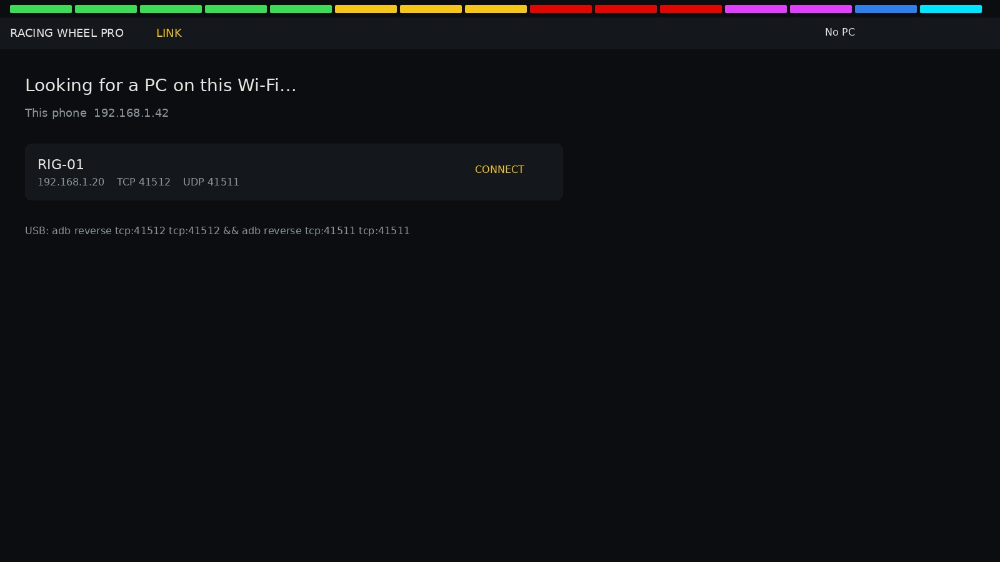
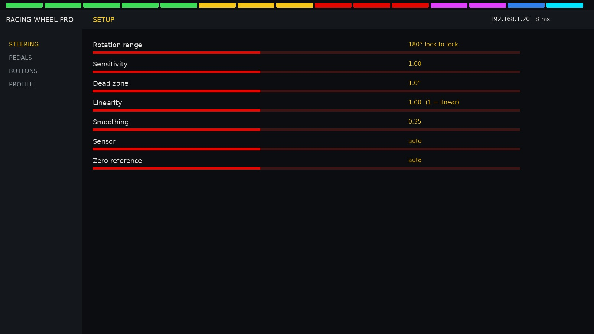
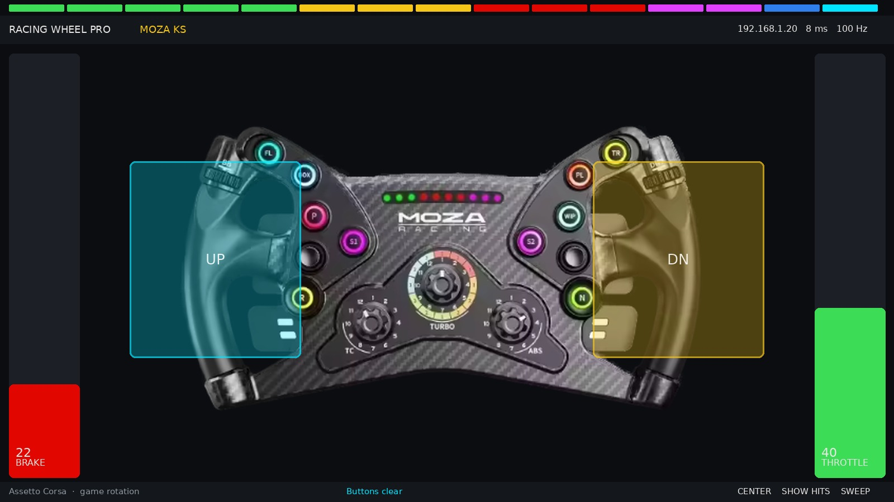
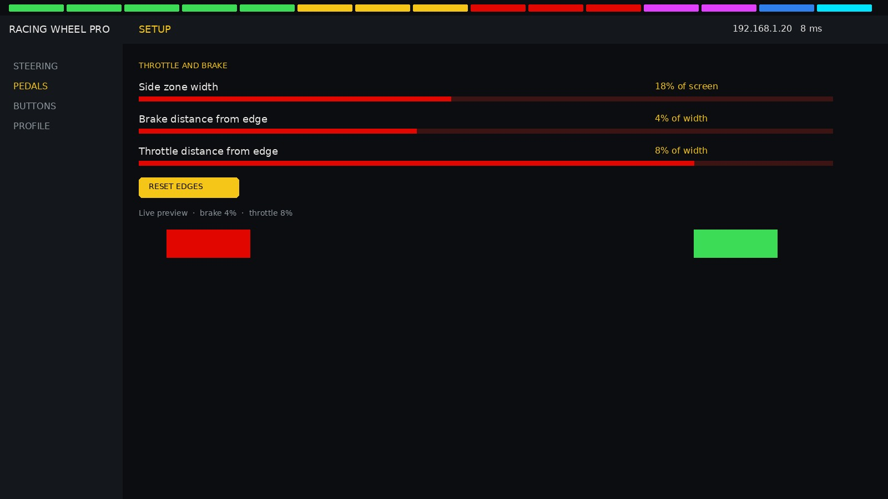
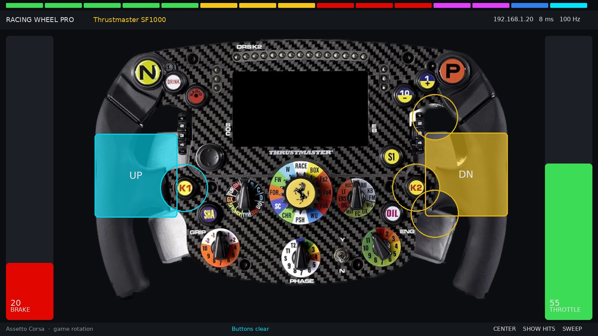
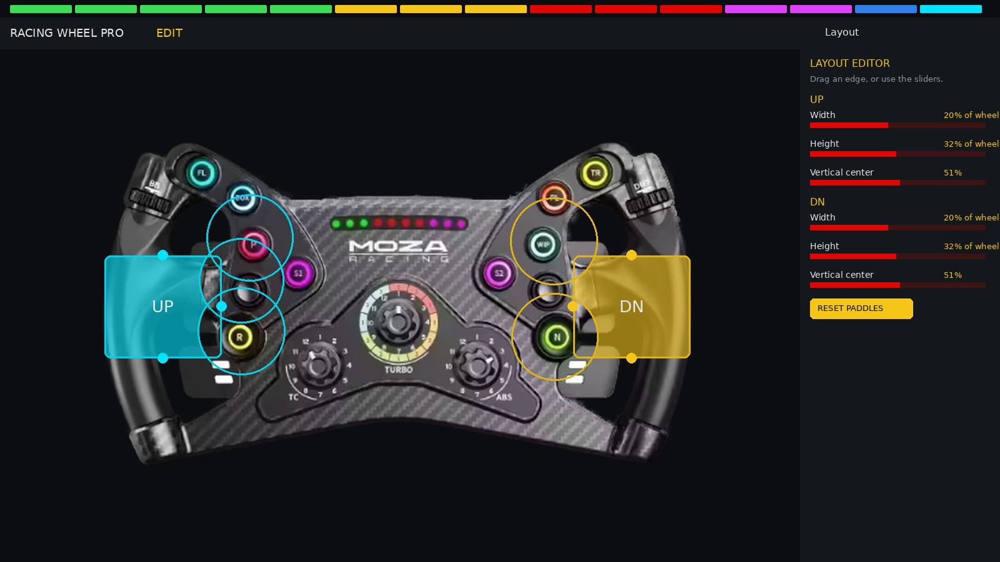
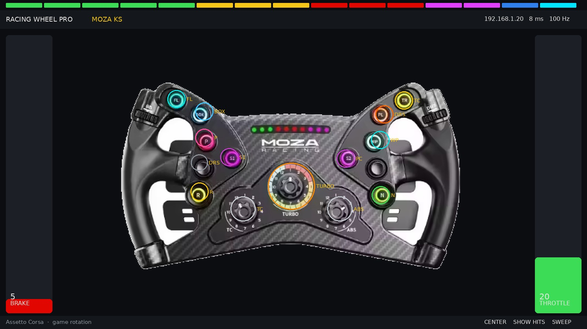
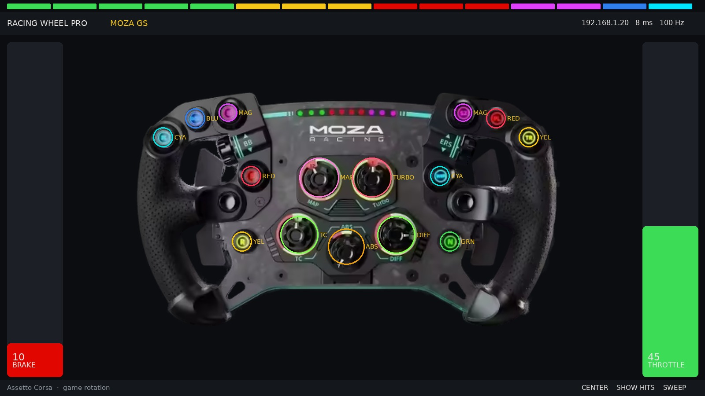

# RacingWheel_V1.0

A racing wheel for racing games built for Android devices with PC plug-in based on Touch Racer Github repo.

Racing Wheel Pro turns a phone into a steering wheel for PC sim racing. The Android app is landscape and full screen. You roll the phone to steer, and the sides of the screen are the brake and the throttle. Buttons and rotary knobs are hotspots on a wheel picture, so they stay under your thumbs while that picture rotates with the steering angle. A Windows receiver takes the stream and presents it to games as a virtual controller.

Copyright (C) 2026 Racing Wheel Pro contributors. Licensed under the GNU General Public License v3.0, with the additional permissions in [LICENSE_EXCEPTIONS](LICENSE_EXCEPTIONS). See [License](#license).

## Website

The promotional site lives in [`website/`](website/). Its canonical address is <https://myracingwheel.site/>. The privacy policy is <https://myracingwheel.site/privacy>.

## Free and Premium

Version 0.5.2 is a test build (GitHub prerelease). The website download stays on 0.5.0. The app keeps every driving feature in the free build and locks the extra wheel pictures. The driving coach is a separate website account. Every wheel has paddle zones (left is shift up, right is shift down), and each pedal can sit in from the screen edge.

The free build includes four wheels, chosen because their numbered dials line up with the hotspot centers: MOZA KS, Thrustmaster SF1000, Mercedes-AMG F1 (the STRAT and HPP rings), and the Ascher McLaren. The other templates stay in the garage as locked tiles. The tile and the banner say **Unlock Racing Wheel Premium - $3.99**. Steering, throttle, brake, buttons, the layout editor, and the Windows receiver do not check that lock. One free wheel, the KS, draws the animated dial pointer so the knob feature can be tried.

Gradle flavors are `free` and `premium`. The free flavor compiles with no Play Billing library. The premium flavor on this branch unlocks every wheel and every dial pointer, again with no billing library, which is what keeps the published source fully usable under [LICENSE_EXCEPTIONS](LICENSE_EXCEPTIONS). The Play Billing client for the one-time product `racing_wheel_premium` lives only on the `paid-version` branch and is not merged. The split is written out in [docs/BILLING.md](docs/BILLING.md).

Package id is `site.myracingwheel.app`. `targetSdk` is 35. Release builds run R8.

### Store names

Google Play regularly rejects apps that use Ferrari, Porsche, Mercedes, McLaren, MOZA, and the other names in this repo without a license, especially once money is involved. A store build hides those names in the UI:

```bash
./gradlew :app:bundlePremiumRelease -Pracingwheel.genericNames=true
```

`RWP_GENERIC_NAMES=true` does the same thing. Titles become "F1 Wheel A", "GT3 Wheel B", and the rest, grouped as Formula, GT, Cup, and Road. The PNG files are not removed or altered. The photographs can still get a listing removed. Read [play-store/PUBLISHING.md](play-store/PUBLISHING.md) before uploading a bundle. Do not put those brand names in the Play listing. The listing text in `play-store/listing/` is the one written for the store.

## Screenshots

These are rendered previews of the app chrome, drawn from the same wheel images and hotspot JSON the app ships. They are not photographs of a handset.

| Drive | Layout editor |
| --- | --- |
|  |  |

| Link | Steering setup |
| --- | --- |
|  |  |

| Paddle zones | Pedal edge inset |
| --- | --- |
|  |  |

| SF1000 paddles | Edit tab |
| --- | --- |
|  |  |

Hotspot rings on the KS and GS templates:




## Features

- Wheel templates grouped by manufacturer: Porsche, McLaren, Audi, BMW, Ferrari, Mercedes, Alfa Romeo, KTM, and MOZA. Each one is a wheel image plus a JSON layout of every button and knob.
- A layout editor. Drag a hotspot, nudge it, resize it, add a button or knob, delete one, save the layout on the phone, copy the JSON, or reset to the built-in map. The drive screen can draw the same rings.
- Steering from the game-rotation sensor, the accelerometer, or a finger drag when the phone has no usable sensor. Range, sensitivity, dead zone, linearity, smoothing, invert, center calibration, and a haptic tick at full lock.
- Separate throttle and brake, with position or relative travel, curves, dead zones, outer clamp, invert, instant or fade release, an exclusive-axis option, an optional clutch strip, and a per-pedal inset from the screen edge.
- Gearshift zones on every wheel. The left rectangle is shift up and the right rectangle is shift down. Each one starts at 20% of the wheel width and 32% of its height, sitting on that side's grip and paddle. A button circle is cut out of the zone, so the touch goes to the button. The editor resizes each side. The zones rotate with the picture. The overlay can be hidden.
- Programmable buttons. Each hotspot maps to virtual button 1–32, as momentary, toggle, or long-press. A rotary pulses a left/right pair and also sends a position. Paddles can also be mapped onto a button number.
- Profiles per wheel and per game. The volume keys can be bound to buttons.
- Wi-Fi discovery, a manual IP, or USB through `adb reverse`. The drive screen shows link state, latency, and packet rate.
- A Windows receiver that feeds ViGEm (Xbox 360 pad) or vJoy, and injects keyboard keys for buttons past the pad. Without a driver it still prints a live dashboard. ViGEm rumble is forwarded to the phone as a short vibration.
- An Assetto Corsa coach. The receiver reads the game's shared memory, cuts laps, stores a gzipped log, and (if you opt in) uploads it. The site draws throttle, brake, steering, and speed, keeps a leaderboard, and asks Workers AI for a few notes per session.

## Install the APK

The signed free release build is published as `RacingWheelPro.apk` (the `free` flavor, `app/build/outputs/apk/free/release/app-free-release.apk`). A debug APK of that flavor is `RacingWheelPro-debug.apk`. The Play bundle is a separate artifact. See [play-store/PUBLISHING.md](play-store/PUBLISHING.md).

On the phone, allow installs from your file manager and open the APK. From a computer, with USB debugging on:

```bash
adb install -r RacingWheelPro.apk
```

GitHub APKs are signed with the development keystore in `app/release.keystore` (alias `racingwheelpro`, store and key password `racingwheelpro`) when no upload key is configured. That key makes the GitHub build reproducible. It is not a Play upload key. Set `RWP_UPLOAD_STORE_FILE`, `RWP_UPLOAD_STORE_PASSWORD`, `RWP_UPLOAD_KEY_ALIAS`, and `RWP_UPLOAD_KEY_PASSWORD` in the environment or in `gradle.properties` for a Play upload. Do not commit that keystore.

The app is landscape only and keeps the screen on while it is open.

## Run the Windows receiver

`RacingWheelPro-PC.exe` is a self-contained .NET 8 single-file executable for 64-bit Windows. Windows does not need a separate .NET install.

Games only see a controller after a virtual-pad driver is installed. The exe still runs, and logs every axis and button, if neither driver is present.

**ViGEmBus (recommended).** The receiver creates an Xbox 360 pad: steering on the left stick X, throttle on the right trigger, brake on the left trigger, clutch on the right stick Y when the clutch zone is enabled, and buttons 1–14 on the face buttons, shoulders, menu, stick clicks, and the d-pad. Download the driver from the [ViGEmBus releases](https://github.com/nefarius/ViGEmBus/releases). The project page is [github.com/nefarius/ViGEmBus](https://github.com/nefarius/ViGEmBus). Reboot if the installer asks.

**vJoy**, when you want all 32 buttons and eight axes on one device. Download it from the maintained fork, [jshafer817/vJoy releases](https://github.com/jshafer817/vJoy/releases), or from [SourceForge vJoystick](https://sourceforge.net/projects/vjoystick/). In vJoyConf, set device 1 to 8 axes and 32 buttons. `vJoyInterface.dll` has to be on `PATH` or in the same folder as the exe. The installer normally places it in `System32`.

Start the receiver, then the phone:

```text
RacingWheelPro-PC.exe
RacingWheelPro-PC.exe --simulate          sweep the axes with no phone
RacingWheelPro-PC.exe --output vigem      Xbox pad only
RacingWheelPro-PC.exe --output vjoy       vJoy device 1
RacingWheelPro-PC.exe --output monitor    log only
RacingWheelPro-PC.exe --no-keyboard       do not type keys for buttons 15–32
RacingWheelPro-PC.exe --json              one JSON object per packet
RacingWheelPro-PC.exe --self-test
```

In the game, bind the Xbox pad or the vJoy device. The console prints input Hz over a full second and output Hz for the virtual pad. Output is submitted every 10 ms from the latest sample.

The receiver also opens a page at <http://127.0.0.1:41513/>. That page lists saved sessions, shows a pairing code, and holds the upload switch. Logs are gzipped JSON and CSV in `%AppData%\RacingWheelPro\Logs`. Upload stays off until you turn it on, after the website has accepted the pairing code. See [worker/DEPLOY.md](worker/DEPLOY.md) for the Cloudflare side.

| Phone output | ViGEm Xbox 360 | vJoy |
| --- | --- | --- |
| Steering −1..1 | Left stick X | Axis X |
| Throttle 0..1 | Right trigger | Axis Y |
| Brake 0..1 | Left trigger | Axis Z |
| Clutch 0..1 | Right stick Y when clutch is used | Axis Rx |
| Knob slots 0–3 | Right stick X/Y for the first two | Ry, Rz, Slider, Dial |
| Buttons 1–14 | A B X Y LB RB Back Start LS RS, d-pad | Buttons 1–14 |
| Buttons 15–32 | Keyboard: F1–F12, then 1–0, then A… | Buttons 15–32 |
| Shift up (left paddle) | Keyboard Page Up, plus a virtual button if the profile sets one | Button 31, and Page Up |
| Shift down (right paddle) | Keyboard Page Down, plus a virtual button if the profile sets one | Button 32, and Page Down |

Button 1 is bit 0 of the button mask.

## Connect the phone to the PC

Both devices need to be on the same Wi-Fi. Start `RacingWheelPro-PC.exe` first. The phone broadcasts a find packet and lists any PC that answers. Tap the PC on the Link screen, or turn on auto-connect in the profile. The status line shows the address, latency from the TCP ping, and how many packets went out in the last second.

If discovery does not cross the network, type the PC's IPv4 address and tap **CONNECT IP**. The default ports are UDP `41510` (discovery), UDP `41511` (telemetry, about 100 Hz), and TCP `41512` (hello and ping).

Over USB, with the phone in debugging mode:

```bash
adb reverse tcp:41512 tcp:41512
adb reverse tcp:41511 tcp:41511
adb reverse tcp:41510 tcp:41510
```

On the phone, open Link and tap **USB / ADB**. The app then talks to `127.0.0.1`, and `adb reverse` forwards those ports to the PC.

## Wheel templates

A template is one PNG and one JSON file in `app/src/main/assets/wheels/`. The picture rotates with the steering angle. Touch points are rotated back into the picture before the hit test, so a finger stays on the button drawn under it. The editor writes an override in the app's private files. **RESET** deletes that override and reloads the asset.

| Id | Wheel | Face buttons | Rotaries |
| --- | --- | --- | --- |
| `moza_fsr` | FSR-style formula wheel with a dashboard screen | 10 | 7, including the two thumb encoders |
| `moza_ks` | KS / GT wheel with side buttons | 11 | 3 (TURBO, TC, ABS) |
| `moza_fsr2` | FSR2-style formula wheel with a wide dash | 9 | 5 (MGU, MIX, ERS, TC, ABS) |
| `moza_gs` | GS-style wheel | 10 | 5 (MAP, TURBO, TC, ABS, DIFF) |

Car wheels ship beside those four. A button counts as one programmable slot and a rotary counts as two. Every template stays between 4 and 18 slots.

| Manufacturer | Id | Name | Buttons | Rotaries |
| --- | --- | --- | --- | --- |
| Porsche | `porsche_gt3r_screen` | Porsche GT3 R screen | 10 | 4 |
| Porsche | `porsche_gt3r_grid` | Porsche GT3 R GRID | 10 | 4 |
| Porsche | `porsche_gt3r_color` | Porsche GT3 R screen color | 10 | 4 |
| Porsche | `porsche_rsr_f` | Porsche 911 RSR F-style | 8 | 5 |
| Porsche | `porsche_911_rsr` | Porsche 911 RSR yellow | 11 | 2 |
| Porsche | `porsche_gt_dash` | Porsche GT dash | 10 | 3 |
| Porsche | `porsche_fanatec_gt3r` | Fanatec 911 GT3 R round | 13 | 2 |
| Porsche | `porsche_gt3r` | Porsche GT3 R | 10 | 4 |
| Porsche | `porsche_gt3_cup` | Porsche 911 GT3 Cup | 10 | 2 |
| McLaren | `mclaren_artura` | McLaren Artura | 14 | 2 |
| McLaren | `mclaren_fanatec_gt3` | Fanatec McLaren GT3 | 12 | 3 |
| McLaren | `mclaren_gt3_diy` | McLaren GT3 DIY | 10 | 4 |
| McLaren | `mclaren_gt3_okx` | McLaren GT3 OKX | 10 | 3 |
| McLaren | `mclaren_gtr_lm` | McLaren GTR LM | 10 | 2 |
| McLaren | `mclaren_f1_mcl` | McLaren F1 MCL | 10 | 3 |
| McLaren | `mclaren_f1_mcl_2` | McLaren F1 MCL 2 | 10 | 3 |
| McLaren | `mclaren_ascher_dark` | Ascher McLaren GT dark | 14 | 2 |
| Ferrari | `ferrari_road_red` | Ferrari Road red | 7 | 1 |
| Ferrari | `ferrari_sf1000` | Thrustmaster SF1000 | 11 | 3 |
| Ferrari | `ferrari_488_gt3` | Thrustmaster 488 GT3 | 10 | 2 |
| Ferrari | `ferrari_f1_2012` | Ferrari F1 2012-style | 7 | 4 |
| Ferrari | `ferrari_sf_f1` | Ferrari SF F1 carbon | 7 | 3 |
| Ferrari | `ferrari_road_blue` | Ferrari Road blue | 6 | 1 |
| Ferrari | `ferrari_458_black` | Ferrari 458 black | 6 | 1 |
| Mercedes | `mercedes_amg_f1` | Mercedes-AMG F1 W-series | 12 | 3 |
| Mercedes | `mercedes_cube_gt3` | Mercedes-AMG GT3 (Cube Controls) | 12 | 2 |
| Mercedes | `mercedes_gt_diy` | Mercedes GT DIY | 6 | 2 |
| Mercedes | `mercedes_f1_2014` | Mercedes F1 2014-style | 6 | 2 |
| Mercedes | `mercedes_road_carbon` | Mercedes-AMG Road Carbon | 7 | 0 |
| Mercedes | `mercedes_road_led` | Mercedes-AMG Road LED | 7 | 0 |

Audi, BMW, Alfa Romeo, and KTM are in the garage with a Coming soon state. Adding a wheel is a PNG plus a JSON file whose `manufacturer` field is that brand.

Porsche, McLaren, Audi, BMW, Ferrari, Mercedes-AMG, Alfa Romeo, KTM, MOZA, Fanatec, Thrustmaster, Cube Controls, Ascher, and the wheel designs in these pictures are trademarks of their owners. The images are here for layout testing only. They are not those products, and those owners have not endorsed this project.

Google Play's IP rules are stricter than a GitHub README. Shipping those names or those photographs in a paid listing is a common cause of rejection or removal. The store build switch and the reasons are in [play-store/PUBLISHING.md](play-store/PUBLISHING.md).

To add a wheel later, put a new PNG next to a JSON file in the same folder and rebuild. `tools/make_assets.py` regenerates the four shipped layouts from the source renders in `tools/sources/`. The editor can place rings on a new photo without measuring pixels by hand. The planned set is the wheels people actually drive in sims: current F1, GT3, LMP, and rally.

### Template JSON

`schema` is `racing-wheel-pro.template/v1`. `manufacturer` is optional and groups the garage. If it is missing, a maker that contains MOZA is grouped as MOZA, and any other maker is left ungrouped. `cx`, `cy`, and `r` are fractions of the image. `r` is a fraction of the width, so a circle stays round in pixels. `hitSlop` grows the touch target without moving the drawn ring. `kind` is `button` or `rotary`. `shape` is `circle`. `defaultButton`, `decButton`, and `incButton` are the suggested virtual-button numbers. A profile can override them. `knobSlot` is 0–7 and selects which knob byte is sent on the wire.

A rotary also has `positions`, `startAngle`, and `clockwise`. `startAngle` is degrees clockwise from 3 o'clock in screen space, where y grows downward. −90 is 12 o'clock and is the default. Detent 0 sits on that angle. The next detent is one step clockwise when `clockwise` is true. The drive screen draws a pointer on that detent, plus a − and a + on the knob. Tapping them, or dragging around the knob, snaps to the nearest printed mark and pulses the decrement or increment button once per step. The knob byte still carries the absolute position. `tools/render_knob_overlays.py` draws the same pointer onto the wheel art and writes `docs/knobs/`.

```json
{
  "schema": "racing-wheel-pro.template/v1",
  "id": "moza_fsr",
  "name": "MOZA FSR",
  "maker": "MOZA Racing",
  "manufacturer": "MOZA",
  "style": "formula",
  "image": "moza_fsr_screen.png",
  "imageWidth": 1280,
  "imageHeight": 720,
  "blurb": "Formula wheel with a dashboard screen.",
  "hitSlop": 0.008,
  "controls": [
    {
      "id": "box",
      "label": "BOX",
      "kind": "button",
      "shape": "circle",
      "cx": 0.27891,
      "cy": 0.25139,
      "r": 0.01406,
      "color": "#F5C400",
      "defaultButton": 2
    },
    {
      "id": "map",
      "label": "MAP",
      "kind": "rotary",
      "shape": "circle",
      "cx": 0.38281,
      "cy": 0.59722,
      "r": 0.03281,
      "color": "#7CFF4A",
      "positions": 12,
      "knobSlot": 2,
      "decButton": 15,
      "incButton": 16
    }
  ]
}
```

## Settings

Open **SETUP** on the phone. Changes are stored in the active profile.

### Steering

Hold the phone in landscape with the screen facing you. Upright is center. Roll it like a wheel. **CENTER** captures your current pose as zero. If the sensor never arrives, drag the wheel art sideways. That touch-steer path also turns on when the sensor mode is Touch.

| Setting | What it does |
| --- | --- |
| Rotation range | Lock to lock, 40° to 1080°. The default is 180°. Above 180° the angle unwraps so you can go past a single tilt. |
| Sensitivity | Scales the shaped axis, 0.2 to 2. |
| Dead zone | Degrees around center that stay at zero. |
| Linearity | Gamma. 1 is linear. Below 1 is livelier at center. Above 1 softens the center. |
| Smoothing | 0 is raw. Toward 0.9 the axis lags and quiets noise. |
| On-screen rotation cap | How far the picture itself spins. The output axis still uses the full range. |
| Gravity scale | Trims the accelerometer reading around 1.0. |
| Sensor | Auto, game rotation, accelerometer, or touch. Auto prefers the game-rotation vector. |
| Zero reference | Auto, top, or body. Auto uses the screen-facing axis at ranges up to 180° and the body axis beyond that. This is the same idea as Touch Racer's phone-orientation setting. |
| Invert | Flips left and right. |
| Haptics | A short vibration on button presses and when the axis first hits full lock. |
| Auto-center | The first sensor sample after start becomes zero. |
| Fastest sensor rate | Uses the fastest Android sensor delay instead of the game rate. |

### Throttle and brake

The left strip is the brake. The right strip is the throttle. A clutch strip appears under the wheel when that option is on.

| Setting | What it does |
| --- | --- |
| Mode | Position uses finger height in the zone. Relative adds millimetres of drag, which is how Touch Racer scaled a swipe. |
| Gamma | Separate curves for throttle, brake, and clutch. |
| Dead zone | Input below this fraction stays at zero. |
| Outer | Input at this fraction is already full scale. |
| Side zone width | How much of the screen each pedal owns. |
| Relative travel | Millimetres of drag that reach full pedal, in relative mode. |
| Release | Instant drops the pedal when the finger lifts. Fade eases it out. |
| Bottom is full | The bottom of the zone is 100%. Turn it off to make the top the full pedal. |
| Invert | Flips that pedal's output. |
| Clutch zone | Shows the third pedal. |
| Exclusive axes | The larger of throttle and brake wins, and the other is forced to zero. |
| Brake distance from edge | How far the brake sits in from the left bezel, 0–10% of screen width. 0% is flush. |
| Throttle distance from edge | The same for the throttle and the right bezel. The two sliders are independent. Reset edges puts both back to 0%. |

### Buttons

Each hotspot has a virtual button number from 1 to 32, or none. Momentary holds the button while the finger is down. Toggle flips on a short release. Long-press holds the primary button until 400 ms, then switches to the long-press button. A rotary sends a decrement button and an increment button as short pulses, and stores a position in its knob slot. Volume up and volume down can each be mapped to a button number so the phone's keys become wheel buttons.

### Shifter zones

Every wheel reserves a rectangle on each side for the paddle shifters. The left rectangle is shift up. The right rectangle is shift down. The default is 20% of that wheel's width, measured inward from the wheel plate, and 32% of the plate's height, centered on the grip. Templates whose art sits higher or lower carry their own center. Those defaults are `wheelBounds` and `shifters` in the template JSON. `WIDTH_FRACTION` and `HEIGHT_FRACTION` in `ShifterZones.kt` are the fallback.

The rectangles are part of the wheel picture. Steering rotates them with the art, and the hit test unwinds that rotation, so a tap lands on the paddle that is drawn under the finger. Once the finger is down, the shift stays held while the wheel turns, the same way a face button stays held. Where the rectangle crosses a button or a knob, that circle plus a small margin is cut out of the zone. The overlay draws only that bite, a half circle when the control sits on the edge, and a touch there presses the button. Other buttons are not highlighted. Moving a hotspot or resizing a paddle recomputes the cut-out.

The layout editor resizes each paddle on its own. Drag the inner edge for width, the top or bottom edge for height, or the middle to slide it. The sliders do the same thing. **RESET PADDLES** restores this wheel's defaults. Width is 8–45% of the wheel, height is 16–65%, and the band stays on the plate. The sizes are stored in the profile.

Show shifter zones draws a faint overlay. Hiding it does not turn the paddles off. Shift up and shift down can each be given a virtual button. Leave the number at 0 and the paddle uses only the gear channel.

The public Telegram channel is https://t.me/racingwheelpro, the `telegram` field in `community.json` at the repo root. The phone, the receiver, and the website all read that one value. On the phone it is Setup → Profile → Join our Telegram. The receiver prints it at startup and links it from the local page.

The receiver reads that channel from byte 32 of the state packet. Bit 0 is shift up and bit 1 is shift down. It types Page Up and Page Down. On vJoy it holds button 31 for shift up and button 32 for shift down when the device has at least 32 buttons. Open vJoyConf, set device 1 to 8 axes and 32 buttons, apply, and restart the receiver. With fewer buttons the console names the last two it can use, and those can overlap wheel buttons until the count is 32. `--no-keyboard` skips the Page Up and Page Down keys. The vJoy buttons and any virtual button you assigned still go out. An Xbox pad from ViGEm has no button 31, so when that pad is the wheel the receiver also opens vJoy and puts only the two paddle buttons on it. Assetto Corsa then sees two different joystick buttons.

## Protocol

RWP1 is little-endian. The version byte is 1. It is a new layout, not Touch Racer's `ru.thelv.joy` packet, because this app has separate pedals and 32 buttons.

The phone sends a find (`RWPF`, 24 bytes, name in 16 bytes) to UDP port 41510. The PC answers with a host beacon (`RWPH`): version, capability bits (1 ViGEm, 2 vJoy, 4 keyboard), TCP port, UDP port, and a name. The PC also broadcasts that beacon.

State (`RWPS`, 36 bytes) goes to UDP 41511 about 100 times a second. TCP carries the hello and the latency ping. An earlier build also wrote every state packet to TCP and flushed it; that stalled the sender, so the copy was removed.

| Offset | Type | Field |
| --- | --- | --- |
| 0 | 4 bytes | `RWPS` |
| 4 | u8 | version = 1 |
| 5 | u8 | flags, bit 0 = touch-steer |
| 6 | u16 | sequence |
| 8 | i16 | steer, −32767..32767 |
| 10 | u16 | throttle, 0..65535 |
| 12 | u16 | brake, 0..65535 |
| 14 | u16 | clutch, 0..65535 |
| 16 | u32 | buttons, bit 0 = button 1 |
| 20 | i8 × 8 | knob positions |
| 28 | u32 | client time, milliseconds |
| 32 | u8 | gear. Bit 0 = shift up (left paddle), bit 1 = shift down (right paddle). Older receivers leave this byte unread. |
| 33 | u8 | reserved |
| 34 | u16 | reserved |

TCP frames are a type byte, a little-endian length, and a payload. Type 1 is a JSON hello (`name`, `wheel`, `profile`, `protocol`). Type 2 is a state packet. Type 3 is a ping (`u32` client time). Type 4 is a pong (echoed client time, then server time). Type 5 is goodbye. The phone shows half of that round trip as latency.

Rumble (`RWPR`, large motor, small motor) travels back to the UDP port the phone is sending from. The phone vibrates when the large motor is active.

## Build from source

### Android

JDK 17 or 21, and Android SDK 35 (`platforms;android-35` and `build-tools;35.0.0`).

```bash
export ANDROID_HOME="$HOME/Android/Sdk"    # or sdk.dir in local.properties
./gradlew :app:assembleFreeDebug           # free debug APK
./gradlew :app:assemblePremiumDebug        # open premium debug APK, every wheel
./gradlew :app:assembleFreeRelease         # signed free release APK, R8 on
./gradlew :app:bundleFreeRelease           # free AAB
./gradlew :app:bundlePremiumRelease -Pracingwheel.genericNames=true
./gradlew :app:test                        # packet, geometry, curve, knob, and catalog tests
```

`assembleDebug` and `assembleRelease` without a flavor are not valid anymore. Name `free` or `premium`.

`./gradlew test` runs on the JVM. It checks the state packet, the rotation used to keep a touch on a spinning button, and the pedal and steering curves.

Regenerate template art after you edit `tools/make_assets.py`:

```bash
python3 tools/make_assets.py
python3 tools/render_previews.py
```

### Windows receiver

The .NET 8 SDK. From `pc/`:

```bash
dotnet run -c Release -- --self-test
dotnet publish -c Release -r win-x64 --self-contained true \
  -p:PublishSingleFile=true \
  -p:IncludeNativeLibrariesForSelfExtract=true \
  -p:EnableCompressionInSingleFile=true \
  -o publish
```

`publish/RacingWheelPro-PC.exe` is the file to copy to Windows. The same project runs on Linux as a monitor (`dotnet run -c Release -- --output monitor`) so the protocol can be tested without ViGEm.

## Roadmap

Further wheel templates, loaded the same way as the MOZA set: current Formula 1 wheels, GT3 wheels, LMP and prototype wheels, and rally wheels. After those, Bluetooth for crowded Wi-Fi, a per-button keyboard map stored in the profile, game telemetry so the shift lights show RPM and the flag, force feedback beyond rumble, and a Linux build of the receiver using uinput.

Version history is in [CHANGELOG.md](CHANGELOG.md).

## Credits

Racing Wheel Pro is based on **Touch Racer** by Vasiliy Shirkin (thelv).

- Repository: [github.com/thelv/touchracer](https://github.com/thelv/touchracer)
- Site: [touchracer.com](https://touchracer.com/)

Touch Racer is the source of the idea and of the approach this app keeps: discover the PC on the local network, send a compact steering and pedal packet, read tilt from the accelerometer or the game-rotation vector and unwrap it past 180°, scale pedal travel in millimetres, and hand the result to a virtual game controller. The on-screen controls were redesigned. Touch Racer uses swipes on the two halves of the screen. This app uses hotspots on a wheel image.

MOZA wheel images and the MOZA Racing name are MOZA's trademarks, used in this repository for testing the template format only.

## License

This program is free software under the **GNU General Public License, version 3**. The full text is in [LICENSE](LICENSE). You can redistribute it and modify it under the terms of that license. If you distribute a modified version, the GPL-3.0 obligations apply, including offering the corresponding source.

The following additional permissions are granted under GPL-3.0 section 7. They are written out in [LICENSE_EXCEPTIONS](LICENSE_EXCEPTIONS), and they are the same additional permissions Touch Racer publishes in its own `LICENSE_EXCEPTIONS` file ([upstream copy](https://github.com/thelv/touchracer/blob/master/LICENSE_EXCEPTIONS)).

1. **Original creator's retained rights.** The original creator, Vasiliy Shirkin (thelv), retains the right to use the Touch Racer codebase, and this derivative, in proprietary commercial products without disclosure of additional modifications.

2. **Graphical assets.** Icons, images, and illustrations anywhere in the project may be replaced with proprietary alternatives without disclosure. Those proprietary assets must not be published alongside this code if they are to remain proprietary.

3. **Monetization code.** Advertising, in-app purchases, donations, and other premium-feature code may be kept proprietary without disclosure. That code must not be published alongside this codebase if it is to remain proprietary. Every feature of the application must stay fully functional in the published open-source version, with no need for the proprietary code.

MOZA, MOZA Racing, and the wheel designs shown in the template images are trademarks of their owner. They are included so the hotspot layouts can be tested. They are not a claim of ownership, and they are not a MOZA product.
